# Rapport de TP : Mise en place du protocole SSH

**DGI-ESP / UCAD, L3 GLSI, Services Réseaux Avancés, 2026-2027**

- **Enseignant :** Dr. GUEYE
- **Étudiante :** Fatou SECK

---

## C'est quoi SSH ? (ce que j'ai compris)

**SSH (Secure Shell)** est un protocole qui permet de **se connecter à une autre machine à distance, de façon sécurisée**. Tout ce qui passe entre les deux machines (mot de passe, commandes, fichiers) est **chiffré**, donc personne ne peut le lire sur le réseau.

On a toujours deux rôles :
- le **serveur** : la machine à laquelle on se connecte (elle fait tourner le programme `sshd`) ;
- le **client** : la machine depuis laquelle on se connecte.

Dans ce TP :

| Machine | Rôle | Système | Utilisateur | Adresse IP |
|---|---|---|---|---|
| UBUNTU | Serveur SSH | Ubuntu 24.04 | fatou-seck | 192.168.1.94 |
| Debian-FATOU | Client SSH | Debian | fatou | 192.168.1.112 |

Les deux machines virtuelles (VirtualBox) sont en **mode pont** pour être sur le même réseau. La commande `ip a` affiche l'adresse IP de chaque machine.

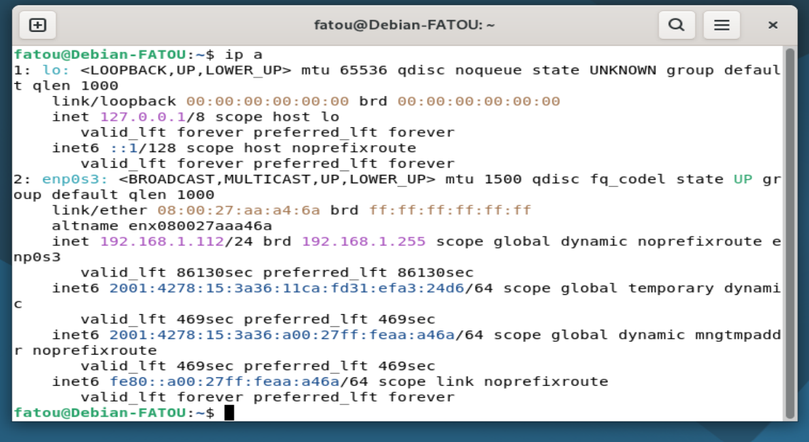
*Figure 1 : IP du client Debian-FATOU (192.168.1.112)*

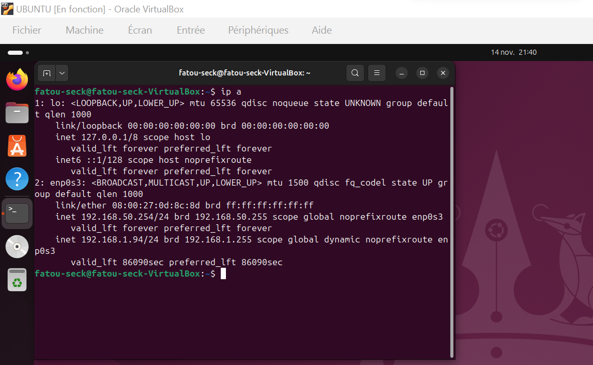
*Figure 2 : IP du serveur UBUNTU (192.168.1.94)*

---

## Étape 1 : Installer le serveur SSH

**Ce qu'on fait :** on installe le programme qui va "écouter" les demandes de connexion sur le serveur UBUNTU.

```bash
sudo apt update
sudo apt install openssh-server
sudo systemctl enable ssh
sudo systemctl start ssh
```

- `apt update` : met à jour la liste des logiciels disponibles.
- `apt install openssh-server` : installe le serveur SSH.
- `systemctl enable ssh` : SSH se lancera tout seul à chaque démarrage.
- `systemctl start ssh` : on le lance maintenant.

On vérifie avec `systemctl status ssh` : le service est **active (running)**, c'est-à-dire qu'il tourne.

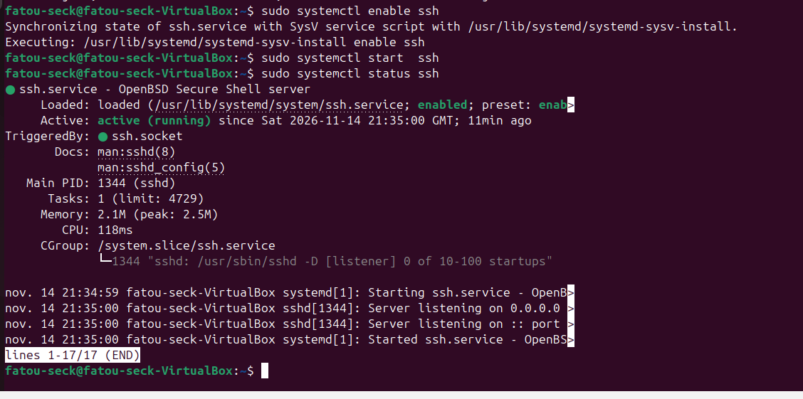
*Figure 3 : Le service SSH est actif*

Puis on vérifie la version installée et le **port 22** :

```bash
apt policy openssh-server
ss -tlnp | grep -w 22
```

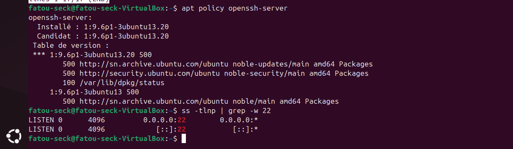
*Figure 4 : openssh-server installé, port 22 en écoute (LISTEN)*

**Ce que j'ai compris :** un **port** est comme une porte d'entrée numérotée d'une machine. SSH utilise le **port 22**. Si le port est en `LISTEN`, le serveur attend des connexions dessus.

---

## Étape 2 : Se connecter depuis le client

**Ce qu'on fait :** depuis Debian, on se connecte au serveur.

```bash
nc -zv 192.168.1.94 22
ssh fatou-seck@192.168.1.94
```

- `nc -zv ... 22` : teste si le port 22 du serveur est ouvert (réponse : `open`).
- `ssh utilisateur@adresse_ip` : ouvre une session sur le serveur.

Au premier accès, SSH affiche l'**empreinte (fingerprint)** du serveur et demande si on lui fait confiance. On répond `yes`, puis on tape le mot de passe.

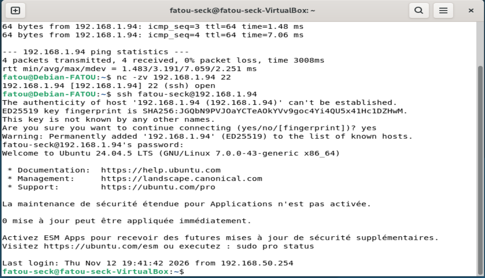
*Figure 5 : Connexion réussie au serveur*

**Ce que j'ai compris :** l'empreinte permet de vérifier qu'on parle bien au bon serveur. Après `yes`, elle est mémorisée dans `~/.ssh/known_hosts`. Si le serveur change un jour (ou si quelqu'un se fait passer pour lui), SSH nous avertit.

---

## Étape 3 : Les clés SSH

**Ce que j'ai compris :** au lieu d'un mot de passe, on peut s'authentifier avec une **paire de clés** :
- la **clé privée** (`id_rsa`) : secrète, elle reste sur la machine qui se connecte ;
- la **clé publique** (`id_rsa.pub`) : on peut la donner. Elle sert de "cadenas" que seule la clé privée peut ouvrir.

### 3.1 Ce que demande le TP : générer les clés sur le serveur

```bash
ssh-keygen -t rsa
```

On appuie sur Entrée (emplacement par défaut) puis deux fois sur Entrée (pas de passphrase). L'image affichée s'appelle **randomart** : c'est une représentation visuelle de la clé.

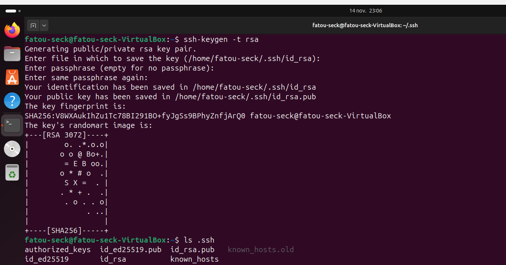
*Figure 6 : Génération de la paire de clés RSA*

On vérifie que le dossier caché `.ssh` existe, puis on regarde dedans :

```bash
ls -a
cd .ssh
ls
```

`ls -a` montre aussi les fichiers cachés. Dans `.ssh`, on trouve `id_rsa` et `id_rsa.pub`.

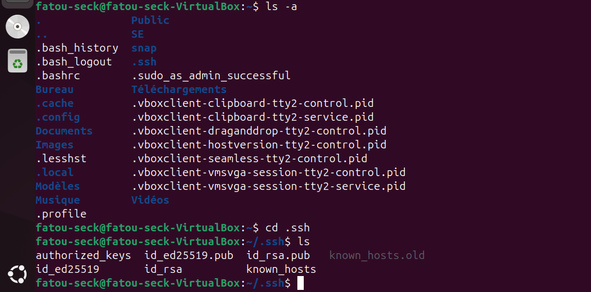
*Figure 7 : Le dossier .ssh contient les clés*

Ensuite, on envoie la clé publique au client avec `scp` :

```bash
scp id_rsa.pub fatou@192.168.1.112:/home/fatou
```

`scp` copie un fichier d'une machine à l'autre **en passant par SSH** (donc chiffré). Le transfert affiche 100 %.

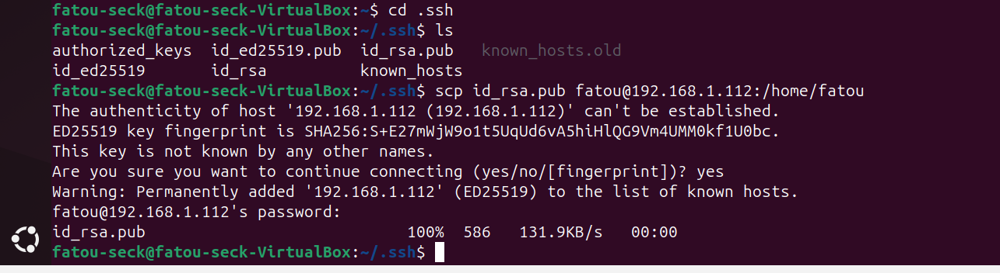
*Figure 8 : Envoi de la clé publique avec scp*

Sur Debian, `ls /home/fatou` montre que le fichier est bien arrivé :

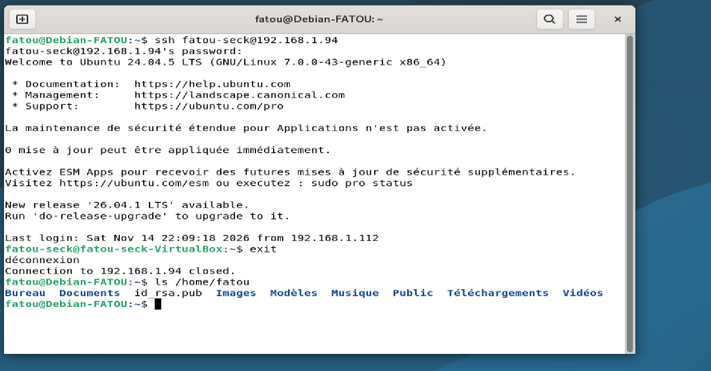
*Figure 9 : id_rsa.pub est présent sur le client*

**Constat :** avec cette méthode, le **mot de passe est encore demandé** (visible sur la figure 9). Pourquoi ? Parce qu'ici on a copié la clé du **serveur** vers le **client**. Or, pour se connecter sans mot de passe, c'est la **clé publique du client** qui doit être enregistrée **sur le serveur**, dans le fichier `~/.ssh/authorized_keys`.

### 3.2 La méthode qui marche : générer les clés sur le client

Sur **Debian** :

```bash
ssh-keygen -t ed25519
ssh-copy-id fatou-seck@192.168.1.94
ssh fatou-seck@192.168.1.94
```

- `ssh-keygen -t ed25519` : crée une paire de clés sur le client.
- `ssh-copy-id` : envoie la clé publique du client dans `authorized_keys` du serveur (le mot de passe est demandé cette dernière fois).
- `ssh ...` : la connexion se fait **sans mot de passe**.

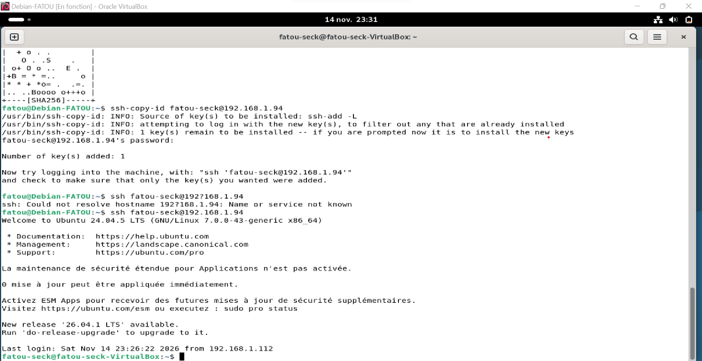
*Figure 10 : ssh-copy-id (1 clé ajoutée), puis connexion sans mot de passe*

**Ce que j'ai compris :** le serveur garde la clé publique du client. À la connexion, il vérifie que le client possède bien la clé privée correspondante. Si oui, il le laisse entrer, sans mot de passe.

---

## Étape 4 : Le tunnel SSH

**Ce que j'ai compris :** un **tunnel SSH** fait passer un autre service (site web, base de données...) **à l'intérieur de la connexion SSH chiffrée**. On accède ainsi à un service distant de façon sécurisée, en n'utilisant que le port 22.

### 4.1 Tunnel vers le serveur web

Le serveur UBUNTU a un serveur web **Nginx** sur le port 80 :

```bash
sudo ss -tlnp | grep :80
curl http://localhost
```

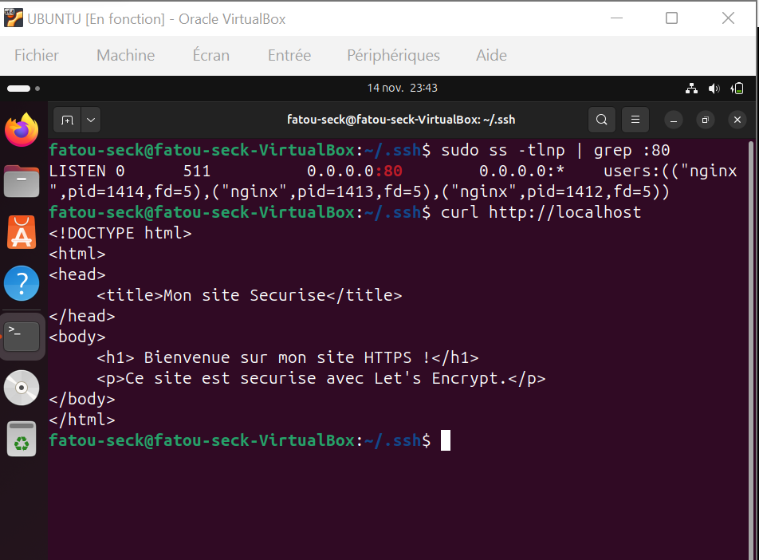
*Figure 11 : Nginx écoute sur le port 80 et envoie la page web*

> J'avais d'abord installé Apache, mais il ne démarrait pas : **Nginx utilisait déjà le port 80**, et deux serveurs ne peuvent pas partager le même port. J'ai donc utilisé Nginx.

Sur **Debian**, on crée le tunnel :

```bash
ssh -L 1024:127.0.0.1:80 fatou-seck@192.168.1.94
```

| Partie | Signification |
|---|---|
| `-L` | Redirection de port locale |
| `1024` | Port ouvert sur **Debian** (le client) |
| `127.0.0.1:80` | Destination : le port 80 **du serveur** (le serveur web) |
| `fatou-seck@192.168.1.94` | Le serveur SSH par lequel on passe |

**En clair :** ce qu'on envoie au port 1024 de Debian arrive, chiffré, au port 80 du serveur. La fenêtre SSH doit **rester ouverte** tant qu'on utilise le tunnel.

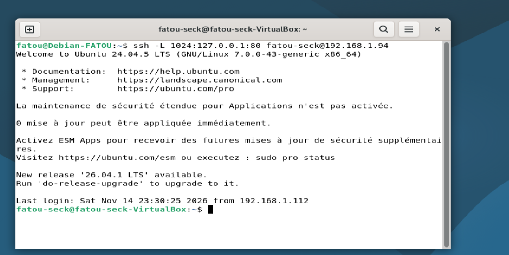
*Figure 12 : Création du tunnel sur le port 1024*

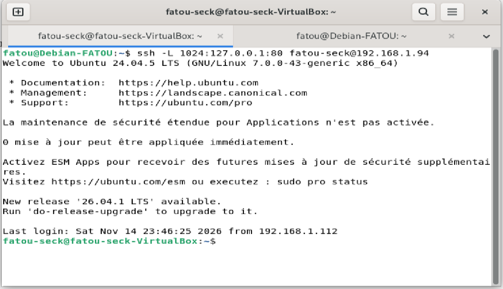
*Figure 13 : Le tunnel est actif (session SSH ouverte)*

Dans Firefox sur Debian, on ouvre `http://localhost:1024` : la page du serveur web **distant** s'affiche. Le tunnel fonctionne.

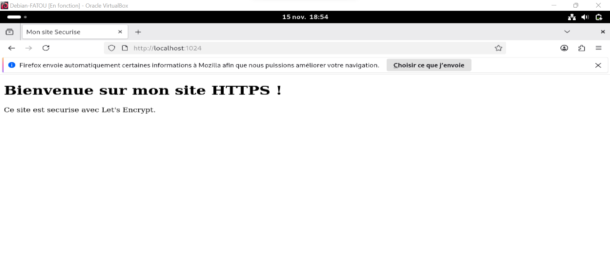
*Figure 14 : La page du serveur s'affiche via localhost:1024*

### 4.2 Tunnel vers la base de données MariaDB

On installe MariaDB sur le serveur et on vérifie qu'elle tourne (port 3306) :

```bash
sudo apt install mariadb-server
sudo systemctl start mariadb
systemctl status mariadb
```

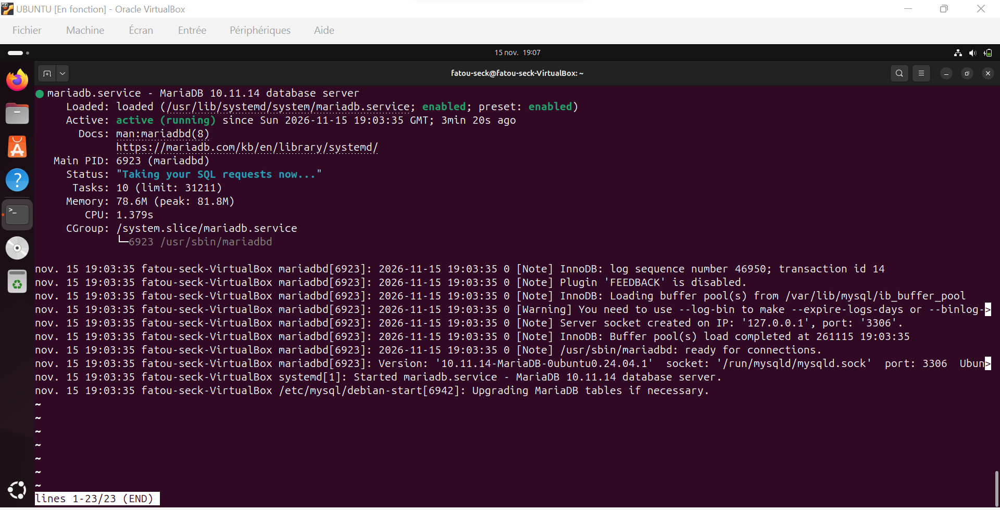
*Figure 15 : Le service MariaDB est actif*

On crée un utilisateur de test dans la console (`sudo mysql`) :

```sql
CREATE USER 'tp'@'localhost' IDENTIFIED BY 'tp123';
GRANT ALL ON *.* TO 'tp'@'localhost';
FLUSH PRIVILEGES;
```

Puis on crée le tunnel (port local 3307 vers le port 3306 de MariaDB) et on se connecte à travers lui :

```bash
ssh -L 3307:127.0.0.1:3306 fatou-seck@127.0.0.1
mysql -h 127.0.0.1 -P 3307 -u tp -p
SHOW DATABASES;
```

Attention : `-P` (majuscule) = **port**, `-p` (minuscule) = **mot de passe**.

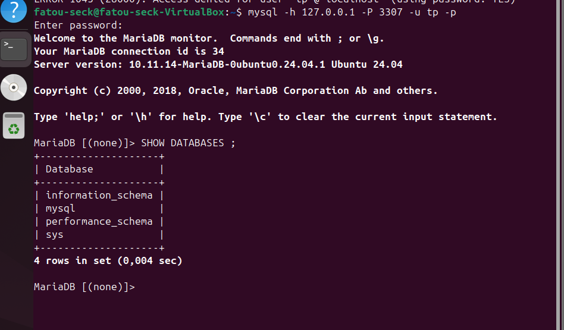
*Figure 16 : Connexion à MariaDB à travers le tunnel, liste des bases*

> **Remarque :** ce test a été fait depuis UBUNTU, car le client `mysql` n'était pas installé sur Debian. Le principe est identique depuis un client distant, avec `ssh -L 3307:127.0.0.1:3306 fatou-seck@192.168.1.94`.

---

## Conclusion : ce que j'ai retenu

- SSH **chiffre** tout ce qui passe entre le client et le serveur.
- Un serveur SSH écoute sur le **port 22**.
- L'**empreinte** du serveur sert à vérifier son identité.
- L'authentification **par clé** est plus sûre que le mot de passe : la clé **privée** reste chez le client, la clé **publique du client** est placée dans `authorized_keys` **du serveur**.
- Un **tunnel SSH** (`ssh -L`) protège un service qui n'est pas chiffré (web, base de données) en le faisant passer par SSH.
